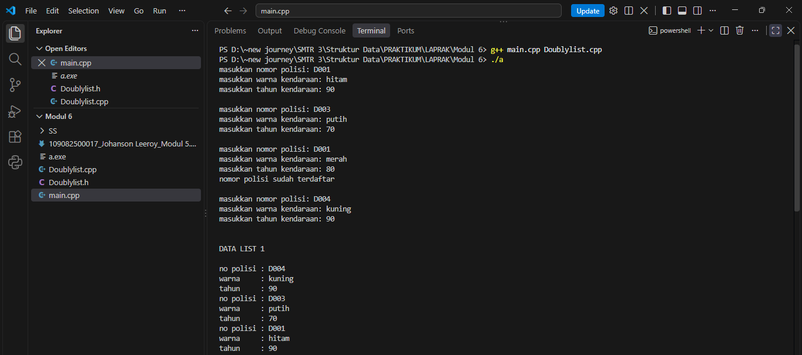
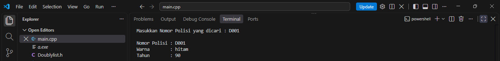
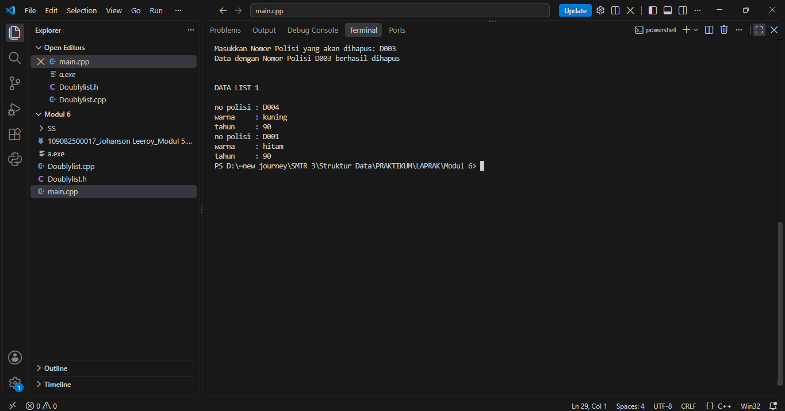

# <h1 align="center">Laporan Praktikum Modul 6 - DOUBLY LINKED LIST (BAGIAN PERTAMA)</h1>

<p align="center">Johanson Leeroy - 109082500017</p>

## Dasar Teori

### A. Doubly Linked List
Doubly Linked list adalah linked list yang masing – masing elemen nya memiliki 2 successor, yaitu
successor yang menunjuk pada elemen sebelumnya (prev) dan successor yang menunjuk pada elemen
sesudahnya (next).

Doubly linked list juga menggunakan dua buah successor utama yang terdapat pada list, yaitu first
(successor yang menunjuk elemen pertama) dan last (susesor yang menunjuk elemen terakhir list).
Komponen-komponen dalam Doubly linked list:
1. First : pointer pada list yang menunjuk pada elemen pertama list.
2. Last : pointer pada list yang menunjuk pada elemen terakhir list.
3. Next : pointer pada elemen sebagai successor yang menunjuk pada elemen didepannya.
4. Prev : pointer pada elemen sebagai successor yang menunjuk pada elemen dibelakangnya.

## Guided

### 1. Header list

```C++
#ifndef LISTMAKANAN_H
#define LISTMAKANAN_H
#define Nil NULL

#include <iostream>
using namespace std;

struct makanan
{
    string nama;
    string jenis;
    float harga;
    float rating;
};

typedef makanan dataMakanan;

typedef struct node *address;

struct node
{
    dataMakanan isidata;
    address next;
    address prev;
};

struct linkedlist
{
    address first;
    address last;
};

bool isEmpty(linkedlist List);
void createList(linkedlist &List);
address alokasi(string nama, string jenis, float harga, float rating);
void dealokasi(address &node);

void insertFirst(linkedlist &List, address nodeBaru);
void insertLast(linkedlist &List, address nodeBaru);
void insertAfter(linkedlist &List, address nodeBaru, address Prev);
void insertBefore(linkedlist &List, address nodeBaru, address nodeNext);

void printList(linkedlist List);

void updateFirst(linkedlist List);
void updateLast(linkedlist List);
void updateAfter(linkedlist List, address prev);
void updateBefore(linkedlist List, address nodeNext);

// Searching
void findByName(linkedlist List, string nama);
void findByJenis(linkedlist List, string jenis);
void findByMinRating(linkedlist List, float minRating);

// Delete
void deleteFirst(linkedlist &List);
void deleteLast(linkedlist &List);
void deleteAfter(linkedlist &List, address Prev);
void deleteBefore(linkedlist &List, address nodeNext);

void deleteNode(linkedlist &List, address target);
void deleteByName(linkedlist &List, string nama);

#endif
```

penjelasan singkat guided 1

File 'listMakanan.h' berisi deklarasi struktur data dan fungsi-fungsi yang digunakan untuk mengelola Doubly Linked List. Di dalamnya terdapat struktur 'makanan' untuk menyimpan nama, jenis, harga, dan rating makanan. Struktur 'node' menyimpan data makanan serta dua pointer, yaitu 'next' untuk menunjuk ke node berikutnya dan 'prev' untuk menunjuk ke node sebelumnya. Struktur 'linkedlist' digunakan untuk menyimpan pointer 'first'sebagai penunjuk node pertama dan 'last' sebagai penunjuk node terakhir. Header ini juga mendeklarasikan berbagai fungsi untuk membuat list, menambah dan menghapus node di posisi tertentu, menampilkan data, memperbarui data makanan, serta mencari makanan berdasarkan nama, jenis, dan rating minimum.

### 2. Code Utama list

```C++
#include "listMakanan.h"
#include <iostream>
#include <string>
using namespace std;

bool isEmpty(linkedlist List)
{
    if (List.first == Nil)
    {
        return true;
    }
    else
    {
        return false;
    }
}

void createList(linkedlist &List)
{
    List.first = Nil;
    List.last = Nil;
}

// pembuatan node baru dengan menerapkan manajemen memori
address alokasi(string nama, string jenis, float harga, float rating)
{
    address nodeBaru = new node;
    nodeBaru->isidata.nama = nama;
    nodeBaru->isidata.jenis = jenis;
    nodeBaru->isidata.harga = harga;
    nodeBaru->isidata.rating = rating;
    nodeBaru->next = Nil;
    nodeBaru->prev = Nil;
    return nodeBaru;
}

void dealokasi(address &node)
{
    node->next = Nil;
    node->prev = Nil;
    delete node;
}

void insertFirst(linkedlist &List, address nodeBaru)
{
    if (isEmpty(List))
    {
        List.first = List.last = nodeBaru;
    }
    else
    {
        nodeBaru->next = List.first;
        List.first->prev = nodeBaru;
        List.first = nodeBaru;
    }
    cout << "Node " << nodeBaru->isidata.nama << " berhasil ditambahkan sebagai node pertama list" << endl;
}

void insertLast(linkedlist &List, address nodeBaru)
{
    if (isEmpty(List) == true)
    {
        List.first = List.last = nodeBaru;
    }
    else
    {
        nodeBaru->prev = List.last;
        List.last->next = nodeBaru;
        List.last = nodeBaru;
    }
    cout << "Node " << nodeBaru->isidata.nama << " berhasil ditambahkan sebagai node terakhir list" << endl;
}

void insertAfter(linkedlist &List, address nodeBaru, address nodePrev)
{
    if (isEmpty(List) == true)
    {
        List.first = List.last = nodeBaru;
    }
    else
    {
        if (nodePrev != Nil)
        {
            if (nodePrev == List.last)
            {
                insertLast(List, nodeBaru);
            }
            else
            {
                nodeBaru->next = nodePrev->next;
                nodeBaru->prev = nodePrev;
                (nodePrev->next)->prev = nodeBaru;
                nodePrev->next = nodeBaru;
                cout << "Node " << nodeBaru->isidata.nama << " berhasil ditambahkan setelah node " << nodePrev->isidata.nama << endl;
            }
        }
        else
        {
            cout << "node sebelumnya (nodePrev) tidak valid!" << endl;
        }
    }
}

void insertBefore(linkedlist &List, address nodeBaru, address nodeNext)
{
    if (isEmpty(List) == true)
    {
        List.first = List.last = nodeBaru;
    }
    else
    {
        if (nodeNext != Nil)
        {
            if (nodeNext == List.first)
            {
                insertFirst(List, nodeBaru);
            }
            else
            {
                nodeBaru->next = nodeNext;
                nodeBaru->prev = nodeNext->prev;
                (nodeNext->prev)->next = nodeBaru;
                nodeNext->prev = nodeBaru;
                cout << "Node " << nodeBaru->isidata.nama << " berhasil ditambahkan sebelum node " << nodeNext->isidata.nama << endl;
            }
        }
        else
        {
            cout << "node setelahnya (nodeNext) tidak valid!" << endl;
        }
    }
}

void printList(linkedlist List)
{
    if (isEmpty(List) == true)
    {
        cout << "List kosong!" << endl;
    }
    else
    {
        address nodeBantu = List.first;
        while (nodeBantu != Nil)
        {
            cout << "Nama makanan : " << nodeBantu->isidata.nama << endl;
            cout << "Jenis        : " << nodeBantu->isidata.jenis << endl;
            cout << "Harga        : " << nodeBantu->isidata.harga << endl;
            cout << "Rating       : " << nodeBantu->isidata.rating << endl;
            cout << "-------------------------------" << endl;
            nodeBantu = nodeBantu->next;
        }
    }
}

void updateFirst(linkedlist List)
{
    if (isEmpty(List) == true)
    {
        cout << "List kosong!" << endl;
    }
    else
    {
        cout << "Masukkan update data node pertama : " << endl;
        cout << "Nama makanan : ";
        getline(cin, List.first->isidata.nama);
        cout << "Jenis makanan : ";
        getline(cin, List.first->isidata.jenis);
        cout << "Harga : ";
        cin >> List.first->isidata.harga;
        cout << "Rating : ";
        cin >> List.first->isidata.rating;
        cin.ignore(); // menghapus karakter newline (/n) dari input buffer
        cout << "Data Berhasil Diupdate!" << endl;
        cout << endl;
    }
}

void updateLast(linkedlist List)
{
    if (isEmpty(List) == true)
    {
        cout << "List kosong!" << endl;
    }
    else
    {
        cout << "Masukkan update data node terakhir : " << endl;
        cout << "Nama makanan : ";
        getline(cin, List.last->isidata.nama);
        cout << "Jenis makanan : ";
        getline(cin, List.last->isidata.jenis);
        cout << "Harga : ";
        cin >> List.last->isidata.harga;
        cout << "Rating : ";
        cin >> List.last->isidata.rating;
        cin.ignore(); // menghapus karakter newline (/n) dari input buffer
        cout << "Data Berhasil Diupdate!" << endl;
        cout << endl;
    }
}

void updateAfter(linkedlist List, address nodePrev)
{
    if (isEmpty(List) == true)
    {
        cout << "List kosong!" << endl;
    }
    else
    {
        if (nodePrev != Nil && nodePrev->next != Nil)
        {
            address nodeBantu = nodePrev->next;
            cout << "masukkan update data node setelah node " << nodePrev->isidata.nama << " : " << endl;
            cout << "Nama makanan : ";
            getline(cin, nodeBantu->isidata.nama);
            cout << "Jenis makanan : ";
            getline(cin, nodeBantu->isidata.jenis);
            cout << "Harga : ";
            cin >> nodeBantu->isidata.harga;
            cout << "Rating : ";
            cin >> nodeBantu->isidata.rating;
            cin.ignore(); // menghapus karakter newline (/n) dari input buffer
            cout << "Data Berhasil Diupdate!" << endl;
            cout << endl;
        }
        else
        {
            cout << "Node sebelumnya (nodePrev) tidak valid!" << endl;
        }
    }
}

void updateBefore(linkedlist List, address nodeNext)
{
    if (isEmpty(List) == true)
    {
        cout << "List kosong!" << endl;
    }
    else
    {
        if (nodeNext != Nil && nodeNext->prev != Nil)
        {
            address nodeBantu = nodeNext->prev;
            cout << "masukkan update data node sebelum node " << nodeNext->isidata.nama << " : " << endl;
            cout << "Nama makanan : ";
            getline(cin, nodeBantu->isidata.nama);
            cout << "Jenis makanan : ";
            getline(cin, nodeBantu->isidata.jenis);
            cout << "Harga : ";
            cin >> nodeBantu->isidata.harga;
            cout << "Rating : ";
            cin >> nodeBantu->isidata.rating;
            cin.ignore(); // menghapus karakter newline (/n) dari input buffer
            cout << "Data Berhasil Diupdate!" << endl;
            cout << endl;
        }
        else
        {
            cout << "Node sebelumnya (prev) tidak valid!" << endl;
        }
    }
}

// SEARCHING
void findByName(linkedlist List, string nama)
{
    if (isEmpty(List))
    {
        cout << "List kosong!" << endl;
        return;
    }
    address p = List.first;
    while (p != Nil)
    {
        if (p->isidata.nama == nama)
        {
            cout << "Ditemukan (berdasarkan nama):" << endl;
            cout << "Nama makanan : " << p->isidata.nama << endl;
            cout << "Jenis        : " << p->isidata.jenis << endl;
            cout << "Harga        : " << p->isidata.harga << endl;
            cout << "Rating       : " << p->isidata.rating << endl;
            return;
        }
        p = p->next;
    }
    cout << "Data dengan nama \"" << nama << "\" tidak ditemukan." << endl;
}

void findByJenis(linkedlist List, string jenis)
{
    if (isEmpty(List))
    {
        cout << "List kosong!" << endl;
        return;
    }
    address p = List.last;
    while (p != Nil)
    {
        if (p->isidata.jenis == jenis)
        {
            cout << "Ditemukan (berdasarkan jenis):" << endl;
            cout << "Nama makanan : " << p->isidata.nama << endl;
            cout << "Jenis        : " << p->isidata.jenis << endl;
            cout << "Harga        : " << p->isidata.harga << endl;
            cout << "Rating       : " << p->isidata.rating << endl;
            return;
        }
        p = p->prev;
    }
    cout << "Data dengan jenis \"" << jenis << "\" tidak ditemukan." << endl;
}

void findByMinRating(linkedlist List, float minRating)
{
    if (isEmpty(List))
    {
        cout << "List kosong!" << endl;
        return;
    }
    address p = List.first;
    while (p != Nil)
    {
        if (p->isidata.rating >= minRating)
        {
            cout << "Ditemukan (rating >= " << minRating << "):" << endl;
            cout << "Nama makanan : " << p->isidata.nama << endl;
            cout << "Jenis        : " << p->isidata.jenis << endl;
            cout << "Harga        : " << p->isidata.harga << endl;
            cout << "Rating       : " << p->isidata.rating << endl;
            return;
        }
        p = p->next;
    }
    cout << "Tidak ada data dengan rating >= " << minRating << "." << endl;
}

// DELETE
void deleteFirst(linkedlist &List)
{
    if (isEmpty(List) == true)
    {
        cout << "List kosong! Tidak ada node yang dihapus." << endl;
        return;
    }
    address pDel = List.first;
    if (List.first == List.last)
    {
        List.first = List.last = Nil;
    }
    else
    {
        List.first = pDel->next;
        List.first->prev = Nil;
        pDel->next = Nil;
    }
    pDel->prev = Nil;
    cout << "Node " << pDel->isidata.nama << " berhasil dihapus dari posisi pertama." << endl;
    dealokasi(pDel);
}

void deleteLast(linkedlist &List)
{
    if (isEmpty(List) == true)
    {
        cout << "List kosong! Tidak ada node yang dihapus." << endl;
        return;
    }
    address pDel = List.last;
    if (List.first == List.last)
    {
        List.first = List.last = Nil;
    }
    else
    {
        List.last = pDel->prev;
        List.last->next = Nil;
        pDel->prev = Nil;
    }
    pDel->next = Nil;
    cout << "Node " << pDel->isidata.nama << " berhasil dihapus dari posisi terakhir." << endl;
    dealokasi(pDel);
}

void deleteAfter(linkedlist &List, address Prev)
{
    if (isEmpty(List) == true)
    {
        cout << "List kosong! Tidak ada node yang dihapus." << endl;
        return;
    }
    if (Prev == Nil || Prev->next == Nil)
    {
        cout << "Node sebelumnya (Prev) tidak valid atau tidak ada node setelahnya!" << endl;
        return;
    }
    if (Prev->next == List.last)
    {
        deleteLast(List);
        return;
    }
    address pDel = Prev->next;
    Prev->next = pDel->next;
    pDel->next->prev = Prev;
    pDel->next = Nil;
    pDel->prev = Nil;
    cout << "Node " << pDel->isidata.nama << " berhasil dihapus setelah node " << Prev->isidata.nama << "." << endl;
    dealokasi(pDel);
}

void deleteBefore(linkedlist &List, address nodeNext)
{
    if (isEmpty(List) == true)
    {
        cout << "List kosong! Tidak ada node yang dihapus." << endl;
        return;
    }
    if (nodeNext == Nil || nodeNext->prev == Nil)
    {
        cout << "Node setelahnya (nodeNext) tidak valid atau tidak ada node sebelumnya!" << endl;
        return;
    }
    if (nodeNext->prev == List.first)
    {
        deleteFirst(List);
        return;
    }
    address pDel = nodeNext->prev;
    nodeNext->prev = pDel->prev;
    pDel->prev->next = nodeNext;
    pDel->next = Nil;
    pDel->prev = Nil;
    cout << "Node " << pDel->isidata.nama << " berhasil dihapus sebelum node " << nodeNext->isidata.nama << "." << endl;
    dealokasi(pDel);
}

void deleteNode(linkedlist &List, address target)
{
    if (isEmpty(List) == true || target == Nil)
    {
        cout << "Target tidak valid atau list kosong!" << endl;
        return;
    }
    if (target == List.first)
    {
        deleteFirst(List);
    }
    else if (target == List.last)
    {
        deleteLast(List);
    }
    else
    {
        address L = target->prev;
        address R = target->next;
        L->next = R;
        R->prev = L;
        target->next = Nil;
        target->prev = Nil;
        cout << "Node " << target->isidata.nama << " berhasil dihapus dari tengah list." << endl;
        dealokasi(target);
    }
}

void deleteByName(linkedlist &List, string nama)
{
    if (isEmpty(List))
    {
        cout << "List kosong! Tidak ada node yang dihapus." << endl;
        return;
    }

    address target = List.first;
    while (target != Nil && target->isidata.nama != nama)
    {
        target = target->next;
    }
    if (target == Nil)
    {
        cout << "Node dengan nama \"" << nama << "\" tidak ditemukan." << endl;
        return;
    }

    deleteNode(List, target);
    cout << "Node dengan nama \"" << nama << "\" telah dihapus dan didealokasi." << endl;
}
```

penjelasan singkat guided 2

File 'listMakanan.cpp' berisi implementasi dari fungsi-fungsi yang telah dideklarasikan pada header 'listMakanan.h' untuk mengelola Doubly Linked List. Implementasi ini mencakup pembuatan list kosong, alokasi dan dealokasi memori, serta penambahan node di awal, akhir, sebelum, dan sesudah node tertentu. Setiap proses penyisipan dan penghapusan node memperhatikan hubungan pointer 'next' dan 'prev' agar hubungan antarnode tetap terjaga. Selain itu, terdapat fungsi untuk menampilkan seluruh data makanan, memperbarui data pada posisi tertentu, mencari makanan berdasarkan nama, jenis, dan rating minimum, serta menghapus node berdasarkan posisi maupun nama makanan. Karena menggunakan dua pointer penghubung, list dapat ditelusuri dari depan ke belakang maupun dari belakang ke depan.

### 3. Main list

```C++
#include "listMakanan.h"
#include <iostream>

using namespace std;

int main()
{
    linkedlist List;
    address nodeA, nodeB, nodeC, nodeD, nodeE = Nil;
    createList(List);

    dataMakanan dtMakanan;

    nodeA = alokasi("Nasi Rames", "Makanan Berat", 10000, 8.5);
    nodeB = alokasi("Ayam Geprek", "Makanan Berat", 13000, 9.0);
    nodeC = alokasi("Risol Mayo", "Makanan Ringan", 3500, 8.8);
    nodeD = alokasi("Mie Ayam", "Makanan Berat", 15000, 9.9);
    nodeE = alokasi("Donat", "Makanan Ringan", 2000, 7.7);

    insertFirst(List, nodeD);
    insertLast(List, nodeE);
    insertAfter(List, nodeA, nodeD);
    insertBefore(List, nodeC, nodeE);
    insertLast(List, nodeB);
    cout << endl;

    // D - A - C - E - B
    cout << "--- Isi List Setelah Insert ---" << endl;
    printList(List);
    cout << endl;

    updateFirst(List);
    updateLast(List);
    updateBefore(List, nodeC);
    updateAfter(List, nodeA);

    cout << "--- Isi List Setelah Update ---" << endl;
    printList(List);

    cout << endl;

    findByName(List, "Nasgor");
    findByMinRating(List, 9.0);

    deleteByName(List, "Nasgor");
    deleteFirst(List);
    deleteBefore(List, nodeE);

    cout << endl
         << "--- Isi List Setelah Delete ---" << endl;
    printList(List);

    return 0;
}
```

penjelasan singkat guided 3

File 'main.cpp' digunakan untuk menjalankan dan menguji fungsi-fungsi Doubly Linked List pada data makanan. Program diawali dengan membuat list kosong menggunakan 'createList', kemudian mengalokasikan lima node yang berisi data makanan, yaitu Nasi Rames, Ayam Geprek, Risol Mayo, Mie Ayam, dan Donat. Kelima node tersebut dimasukkan ke dalam list menggunakan fungsi 'insertFirst', 'insertLast', 'insertAfter', dan 'insertBefore', sehingga urutan awal list menjadi Mie Ayam, Nasi Rames, Risol Mayo, Donat, dan Ayam Geprek. Selanjutnya, program menampilkan isi list, memperbarui data makanan menggunakan fungsi update, mencari makanan berdasarkan nama dan rating minimum, serta menghapus node menggunakan fungsi 'deleteByName', 'deleteFirst', dan 'deleteBefore'. Terakhir, program menampilkan kembali isi list setelah proses penghapusan untuk melihat perubahan data. Dengan demikian, program utama ini digunakan untuk menguji operasi penambahan, penampilan, pembaruan, pencarian, dan penghapusan data pada Doubly Linked List.

## Unguided

### 1.

#### Header Doublylist
```C++
#ifndef LISTKENDARAAN_H
#define LISTKENDARAAN_H
#define Nil NULL

#include <iostream>
using namespace std;

typedef struct kendaraan infotype;

typedef struct ElmList *address;

struct kendaraan
{
    string nopol;
    string warna;
    int thnBuat;
};

struct ElmList
{
    infotype info;
    address next;
    address prev;
};

struct List
{
    address First;
    address Last;
};

void CreateList(List &L);
address alokasi(infotype x);
void dealokasi(address &P);
void printInfo(List L);
void insertLast(List &L, address &P);
void findElm(List L, infotype x);
void deleteFirst(List &L, address P);
void deleteLast(List &L, address P);
void deleteAfter(address prec, address &P);
void deleteByNopol(List &L, string nopol);
#endif
```

#### Code Utama Doublylist
```C++
#include "Doublylist.h"

void CreateList(List &L)
{
    L.First = Nil;
    L.Last = Nil;
}

address alokasi(infotype x)
{
    address P = new ElmList;

    P->info = x;
    P->next = Nil;
    P->prev = Nil;

    return P;
}

void dealokasi(address &P)
{
    if (P != Nil)
    {
        P->next = Nil;
        P->prev = Nil;

        delete P;
        P = Nil;
    }
}

void printInfo(List L)
{
    address P = L.Last;

    cout << endl;
    cout << "DATA LIST 1" << endl;
    cout << endl;

    while (P != Nil)
    {
        cout << "no polisi : " << P->info.nopol << endl;
        cout << "warna     : " << P->info.warna << endl;
        cout << "tahun     : " << P->info.thnBuat << endl;

        P = P->prev;
    }
}

void insertLast(List &L, address &P)
{
    infotype x;

    cout << "masukkan nomor polisi: ";
    getline(cin, x.nopol);

    address Q = L.First;

    cout << "masukkan warna kendaraan: ";
    getline(cin, x.warna);

    cout << "masukkan tahun kendaraan: ";
    cin >> x.thnBuat;
    cin.ignore(1000, '\n');

    while (Q != Nil)
    {
        if (Q->info.nopol == x.nopol)
        {
            cout << "nomor polisi sudah terdaftar"<< endl;
            cout<< endl;
            P = Nil;
            return;
        }

        Q = Q->next;
    }

    P = alokasi(x);

    if (L.First == Nil)
    {
        L.First = P;
        L.Last = P;
    }
    else
    {
        P->prev = L.Last;
        L.Last->next = P;
        L.Last = P;
    }

    cout << endl;
}


void findElm(List L, infotype x)
{
    cout << "Masukkan Nomor Polisi yang dicari : ";
    getline(cin, x.nopol);

    address P = L.First;

    while (P != Nil)
    {
        if (P->info.nopol == x.nopol)
        {
            cout << endl;
            cout << "Nomor Polisi : " << P->info.nopol << endl;
            cout << "Warna        : " << P->info.warna << endl;
            cout << "Tahun        : " << P->info.thnBuat << endl;

            return;
        }

        P = P->next;
    }

    cout << endl;
    cout << "Nomor polisi " << x.nopol << " tidak ditemukan." << endl;
}


void deleteFirst(List &L, address P)
{
    if (L.First == Nil)
    {
        cout << "List kosong!" << endl;
        P = Nil;
        return;
    }

    P = L.First;

    if (L.First == L.Last)
    {
        L.First = Nil;
        L.Last = Nil;
    }
    else
    {
        L.First = P->next;
        L.First->prev = Nil;
        P->next = Nil;
    }

    cout << "Kendaraan dengan nomor polisi " << P->info.nopol << " berhasil dihapus." << endl;

    dealokasi(P);
}


void deleteLast(List &L, address P)
{
    if (L.Last == Nil)
    {
        cout << "List kosong!" << endl;
        P = Nil;
        return;
    }

    P = L.Last;

    if (L.First == L.Last)
    {
        L.First = Nil;
        L.Last = Nil;
    }
    else
    {
        L.Last = P->prev;
        L.Last->next = Nil;
        P->prev = Nil;
    }

    cout << "Kendaraan dengan nomor polisi " << P->info.nopol << " berhasil dihapus." << endl;

    dealokasi(P);
}

void deleteAfter(address prec, address &P)
{
    string nopol;

    cout << "Masukkan nomor polisi yang ingin dihapus: ";
    getline(cin, nopol);

    if (prec == Nil)
    {
        cout << "List kosong!" << endl;
        P = Nil;
        return;
    }

    address Q = prec;

    while (Q->next != Nil &&
           Q->next->info.nopol != nopol)
    {
        Q = Q->next;
    }

    if (Q->next == Nil)
    {
        cout << "Nomor polisi tidak ditemukan!" << endl;
        P = Nil;
        return;
    }

    P = Q->next;

    Q->next = P->next;

    if (P->next != Nil)
    {
        P->next->prev = Q;
    }

    cout << "Data kendaraan berhasil dihapus:" << endl;
    cout << "Nomor polisi : " << P->info.nopol << endl;
    cout << "Warna        : " << P->info.warna << endl;
    cout << "Tahun        : " << P->info.thnBuat << endl;

    P->next = Nil;
    P->prev = Nil;

    dealokasi(P);
}

void deleteByNopol(List &L, string nopol)
{
    address P = L.First;

    while (P != Nil && P->info.nopol != nopol) {
        P = P->next;
    }

    if (P == Nil) {
        cout << "Nomor polisi tidak ditemukan!" << endl;
        return;
    }

    if (P == L.First) {
        L.First = P->next;

        if (L.First != Nil) {
            L.First->prev = Nil;
        } else {
            L.Last = Nil;
        }
    }
    else if (P == L.Last) {
        L.Last = P->prev;
        L.Last->next = Nil;
    }
    else {
        P->prev->next = P->next;
        P->next->prev = P->prev;
    }

    cout << "Data dengan Nomor Polisi "<< P->info.nopol << " berhasil dihapus"<< endl;

    dealokasi(P);
}
```

#### Main Doublylist
```C++
#include "Doublylist.h"

int main()
{
    List L;
    address P;
    address prec = L.First;
    infotype x;

    CreateList(L);

    insertLast(L, P);
    insertLast(L, P);
    insertLast(L, P);
    insertLast(L, P);

    printInfo(L);
    cout<< endl;
    findElm(L, x);
    cout<< endl;
    string nopol;

    cout << "Masukkan Nomor Polisi yang akan dihapus: ";
    getline(cin, nopol);

    deleteByNopol(L, nopol);
    cout<<endl;
    printInfo(L);

    return 0;
}
```

### Output Unguided 1 :

##### Output 1







penjelasan unguided 1
1. File header (Doublylist.h) mendeklarasikan struktur kendaraan yang memiliki atribut nopol bertipe string untuk menyimpan nomor polisi, warna bertipe string untuk menyimpan warna kendaraan, dan thnBuat bertipe int untuk menyimpan tahun pembuatan kendaraan. Struktur ElmList memiliki atribut info untuk menyimpan data kendaraan, serta next dan prev sebagai pointer ke node berikutnya dan sebelumnya. Sementara itu, struktur List memiliki atribut First dan Last yang menunjuk ke node pertama dan terakhir. File header juga mendeklarasikan prosedur dan fungsi seperti CreateList(), alokasi(), dealokasi(), printInfo(), insertLast(), findElm(), deleteFirst(), deleteLast(), deleteAfter(), dan deleteByNopol() untuk mengelola, menampilkan, mencari, menambahkan, serta menghapus data kendaraan. Penggunaan #ifndef, #define, dan #endif bertujuan untuk mencegah file header dimasukkan berulang kali.

2. File kode utama (Doublylist.cpp) mengimplementasikan prosedur dan fungsi yang telah dideklarasikan pada file header. Prosedur CreateList() digunakan untuk membuat list kosong dengan mengatur First dan Last menjadi Nil. Fungsi alokasi() digunakan untuk membuat node baru yang berisi data kendaraan, sedangkan dealokasi() berfungsi membebaskan memori node yang dihapus. Prosedur printInfo() digunakan untuk menampilkan seluruh data kendaraan dengan menelusuri list dari node terakhir menuju node pertama menggunakan pointer prev. Prosedur insertLast() digunakan untuk menambahkan data kendaraan di akhir list sekaligus memeriksa agar nomor polisi tidak terdaftar lebih dari satu kali. Fungsi findElm() digunakan untuk mencari kendaraan berdasarkan nomor polisi dan menampilkan informasi kendaraan jika ditemukan. Selain itu, deleteFirst() digunakan untuk menghapus node pertama, deleteLast() untuk menghapus node terakhir, dan deleteAfter() untuk menghapus node setelah node tertentu berdasarkan nomor polisi yang dimasukkan. Prosedur deleteByNopol() digunakan untuk mencari dan menghapus node berdasarkan nomor polisi, baik node pertama, terakhir, maupun yang berada di tengah list, dengan memperbarui hubungan pointer next dan prev agar struktur Doubly Linked List tetap terhubung dengan benar.

3. File main (main.cpp) berfungsi sebagai bagian utama program yang menjalankan prosedur dan fungsi Doubly Linked List. Program membuat list kosong menggunakan CreateList(), kemudian memanggil insertLast() sebanyak empat kali untuk memasukkan data kendaraan melalui input pengguna. Setelah itu, printInfo() dipanggil untuk menampilkan seluruh data kendaraan. Program selanjutnya memanggil findElm() agar pengguna dapat mencari kendaraan berdasarkan nomor polisi. Setelah proses pencarian selesai, pengguna memasukkan nomor polisi kendaraan yang ingin dihapus, kemudian deleteByNopol() dijalankan untuk mencari dan menghapus data kendaraan yang sesuai. Terakhir, printInfo() dipanggil kembali untuk menampilkan data kendaraan setelah penghapusan sehingga pengguna dapat melihat perubahan isi list. Program kemudian berakhir dengan return 0.

## Kesimpulan

Di minggu kali ini saya belajar mengenai pengelolaan data kendaraan pada Doubly Linked List menggunakan bahasa pemrograman C++. Saya mempelajari cara menambahkan data kendaraan di akhir list, mencari kendaraan berdasarkan nomor polisi, serta menghapus data kendaraan yang dipilih. Selain itu, saya juga memahami penggunaan prosedur seperti 'insertLast()', 'findElm()', 'deleteFirst()', 'deleteLast()', 'deleteAfter()', dan 'deleteByNopol()' untuk membantu proses pengelolaan data. Dari praktikum ini, saya menjadi lebih memahami cara kerja pointer 'next' dan 'prev' dalam menghubungkan node, serta cara memperbarui hubungan antarnode ketika data ditambahkan atau dihapus agar struktur Doubly Linked List tetap terhubung dengan benar.
...

## Referensi

[1] Triase. (2020). Diktat Edisi Revisi : STRUKTUR DATA. Medan: UNIVERSTAS ISLAM NEGERI SUMATERA UTARA MEDAN.
<br>[2] Indahyati, Uce., Rahmawati Yunianita. (2020). "BUKU AJAR ALGORITMA DAN PEMROGRAMAN DALAM BAHASA C++". Sidoarjo: Umsida Press. Diakses pada 10 Maret 2024 melalui https://doi.org/10.21070/2020/978-623-6833-67-4.
<br>...
