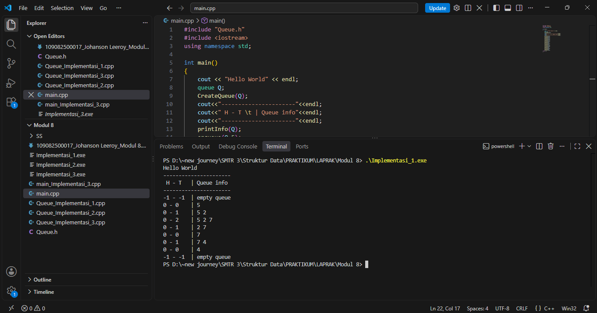
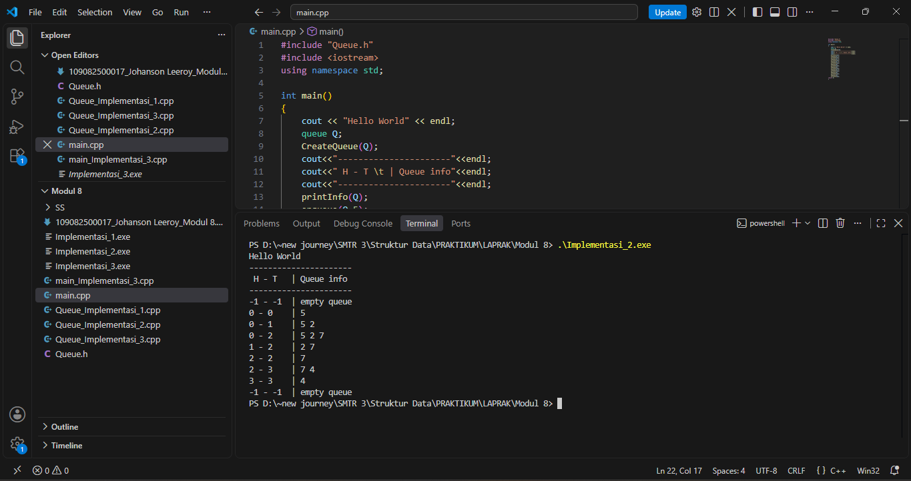
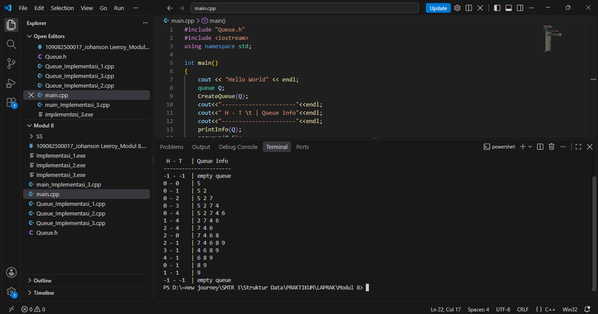

# <h1 align="center">Laporan Praktikum Modul 8 - QUEUE</h1>

<p align="center">Johanson Leeroy - 109082500017</p>

## Dasar Teori

### A. Stack
Queue adalah salah satu struktur data linear yang menggunakan prinsip FIFO (First In, First Out), yaitu data yang pertama kali dimasukkan akan menjadi data pertama yang dikeluarkan. Penambahan data pada Queue dilakukan melalui bagian belakang yang disebut tail, sedangkan penghapusan data dilakukan melalui bagian depan yang disebut head.

Queue memiliki beberapa operasi utama, yaitu enqueue() untuk menambahkan data ke bagian belakang Queue, dequeue() untuk menghapus data paling depan, isEmptyQueue() untuk memeriksa apakah Queue kosong, isFullQueue() untuk memeriksa apakah Queue penuh, dan printInfo() untuk menampilkan isi Queue.

Komponen-komponen dalam Queue:
1. Head: variabel yang menunjukkan posisi elemen paling depan pada Queue.
2. Tail: variabel yang menunjukkan posisi elemen paling belakang pada Queue.
3. Info: array atau tempat penyimpanan yang digunakan untuk menampung elemen-elemen data pada Queue.
4. Enqueue: operasi untuk menambahkan elemen baru ke bagian belakang Queue.
5. Dequeue: operasi untuk mengambil dan menghapus elemen paling depan dari Queue.

Pada implementasinya, Queue dapat menggunakan Array maupun Linked List sebagai media penyimpanan data. Dalam praktikum ini, Queue menggunakan Array dengan tiga metode implementasi, yaitu Head Diam dan Tail Bergerak, Head Bergerak dan Tail Bergerak, serta Head dan Tail Berputar (Circular Queue). Ketiga metode tersebut memiliki cara pengelolaan posisi head dan tail yang berbeda dalam proses penambahan dan penghapusan data. Selain menggunakan Array, Queue juga dapat diimplementasikan menggunakan Linked List, yaitu dengan memanfaatkan node yang saling terhubung untuk menyimpan data. Penggunaan Linked List memungkinkan Queue bertambah secara dinamis sesuai jumlah data yang dimasukkan tanpa harus menentukan kapasitas array sejak awal.

## Guided 1 (Queue dengan Array)

### 1. Header Queue

```C++
#ifndef QUEUE_H
#define QUEUE_H

#include <iostream>
using namespace std;
const int MAKSIMAL = 5;

struct queue{
    string nama[MAKSIMAL];
    int head;
    int tail;
};

bool isFull(queue Q);
bool isEmpty(queue Q);
void CreateQueue(queue &Q);
void enQueue(queue &Q, string nama);
void deQueue(queue &Q);
void viewQueue(queue Q);

#endif
```

penjelasan singkat guided 1

File queue.h berisi deklarasi struktur data dan fungsi-fungsi untuk mengelola Queue menggunakan Array. Struktur queue memiliki array nama dengan kapasitas maksimal 5 elemen, serta variabel head dan tail untuk menunjukkan posisi elemen pertama dan terakhir dalam Queue. Header ini juga mendeklarasikan fungsi untuk mengecek kondisi Queue (isFull dan isEmpty), membuat Queue kosong (CreateQueue), menambahkan data (enQueue), menghapus data (deQueue), dan menampilkan seluruh data (viewQueue).

### 2. Code Utama Queue

```C++
#include "queue.h"
#include <iostream>

using namespace std;

// NOTE : 
// Implementasi 1 = head diam, tail bergerak (Queue Linear Statis, kerana head nya tetap diam)
// Implementasi 2 = head bergerak, tail bergerak (Queue Linear Dinamis, karena head & tail nya sama-sama bergerak)
// Implementasi 3 = head dan tail berputar (Queue Circular, karena jika udh mentok tapi masih ada space, diputar sehingga tail bisa ada didepan head)

bool isEmpty(queue Q){
    if(Q.head == -1 && Q.tail == -1){
        return true;
    } else {
        return false;
    }
}

//isFull implmenetasi 1 & 2
bool isFull(queue Q){
    if(Q.tail == MAKSIMAL - 1){
        return true;
    } else {
        return false;
    }
}

// //isFull implementasi 3
// bool isFull(queue Q){
//     if((Q.tail + 1) % MAKSIMAL == Q.head){
//         return true;
//     } else {
//         return false;
//     }
// }

void CreateQueue(queue &Q){ //terbentuk queue dengan head = -1 dan tail = -1 
    Q.head = -1;
    Q.tail = -1;
}
 

//enqueue implementasi 1 & 2
void enQueue(queue &Q, string nama){
    if(isFull(Q) == true){
        cout << "Queue sudah penuh!" << endl;
    } else {
        if(isEmpty(Q) == true){
            Q.head = Q.tail = 0;
        } else {
            Q.tail++;
        }
        Q.nama[Q.tail] = nama;
        cout << "nama " << nama << " berhasil ditambahkan kedalam queue!" << endl;
    }
}

// //enQueue implementasi 3
// void enQueue(queue &Q, string nama){
//     if(isFull(Q) == true){
//         cout << "Queue sudah penuh!" << endl;
//     } else {
//         if(isEmpty(Q) == true){
//             Q.head = Q.tail = 0;
//         } else {
//             Q.tail = (Q.tail + 1) % MAKSIMAL; // bergerak melingkar
//         }
//         Q.nama[Q.tail] = nama;
//         cout << "nama " << nama << " berhasil ditambahkan kedalam queue!" << endl;
//     }
// }

//dequeue implementasi 1
void deQueue(queue &Q){
    if(isEmpty(Q) == true){
        cout << "Queue kosong!" << endl;
    } else {
        cout << "Mengahapus data " << Q.nama[Q.head] << "..." << endl;
        for(int i = 0; i < Q.tail; i++){
            Q.nama[i] =  Q.nama[i+1];
        }
        Q.tail--;
        if(Q.tail < 0){ //kalo semua isi queue nya udh dikeluarin, set head & tail ke -1
            Q.head = -1;
            Q.tail = -1;
        }
    }
}

// //dequeue implementasi 2
// void deQueue(queue &Q){
//     if(isEmpty(Q) == true){
//         cout << "Queue kosong!" << endl;
//     } else {
//         cout << "Mengahapus data " << Q.nama[Q.head] << "..." << endl;
//         Q.head++;
//         if(Q.head > Q.tail){ //kalo elemennya udh abis (head akan lebih 1 dari tail), maka reset ulang head & tail ke -1
//             Q.head = -1;
//             Q.tail = -1;
//         }
//     }
// }

// //deQueue implementasi 3
// void deQueue(queue &Q){
//     if(isEmpty(Q) == true){
//         cout << "Queue kosong!" << endl;
//     } else {
//         cout << "Mengahapus data " << Q.nama[Q.head] << "..." << endl;
//         if(Q.head == Q.tail){ //kalo elemennya tinggal 1, langsungkan saja head & tail nya reset ke -1
//             Q.head = -1;
//             Q.tail = -1;
//         } else {
//             Q.head = (Q.head + 1) % MAKSIMAL; // bergerak melingkar
//         }
//     }
// }

//viewQueue implementasi 1 & 2
void viewQueue(queue Q){
    if(isEmpty(Q) == true){
        cout << "Queue kosong!" << endl;
    } else {
        for(int i = Q.head; i <= Q.tail; i++){
            cout << i -  Q.head + 1 << ". " << Q.nama[i] << endl;
        }
    }
    cout << endl;
}

// //viewQueue implementasi 3
// void viewQueue(queue Q){
//     if(isEmpty(Q) == true){
//         cout << "Queue kosong!" << endl;
//     } else {
//         int i = Q.head;
//         int count = 1;
//         while(true){
//             cout << count << ". " << Q.nama[i] << endl;
//             if(i == Q.tail){
//                 break;
//             }
//             i = (i + 1) % MAKSIMAL;
//             count++;
//         }   
//     }
// }
```

penjelasan singkat guided 2

File implementasi berisi definisi fungsi-fungsi yang telah dideklarasikan pada queue.h. Queue menggunakan Array dengan konsep FIFO (First In First Out), yaitu data yang pertama masuk akan menjadi data pertama yang keluar. Pada kode terdapat tiga jenis implementasi Queue, yaitu:

1. Implementasi 1 (Head Diam, Tail Bergerak): Posisi head tetap berada di indeks awal, sedangkan tail bergerak setiap kali data baru ditambahkan. Ketika dilakukan penghapusan data, elemen-elemen berikutnya digeser ke posisi sebelumnya agar head tetap berada di indeks awal.

2. Implementasi 2 (Head Bergerak, Tail Bergerak): Posisi head dan tail sama-sama bergerak. Ketika data ditambahkan, tail akan berpindah ke indeks berikutnya, sedangkan ketika data dihapus, head akan berpindah ke indeks berikutnya tanpa perlu menggeser elemen lainnya.

3. Implementasi 3 (Queue Circular): Posisi head dan tail bergerak secara melingkar. Ketika tail mencapai indeks terakhir tetapi masih terdapat ruang kosong di bagian awal Array, posisi tail dapat kembali ke indeks awal menggunakan operasi modulo (%). Dengan demikian, ruang kosong pada Array dapat digunakan kembali.

Selain itu, terdapat beberapa fungsi untuk mengelola Queue. Fungsi CreateQueue() digunakan untuk menginisialisasi Queue dalam keadaan kosong, sedangkan isEmpty() dan isFull() digunakan untuk mengecek kondisi Queue. Fungsi enQueue() digunakan untuk menambahkan data ke dalam Queue, sementara deQueue() digunakan untuk menghapus data paling depan. Terakhir, fungsi viewQueue() digunakan untuk menampilkan seluruh data yang tersimpan dalam Queue.

### 3. Main Queue

```C++
#include "queue.h"
#include <iostream>

using namespace std;

int main(){
    queue Q;

    CreateQueue(Q);
    enQueue(Q, "Dimas");
    enQueue(Q, "Arvin");
    enQueue(Q, "Rizal");
    enQueue(Q, "Hafizh");
    enQueue(Q, "Fathur");
    enQueue(Q, "Daffa");
    cout << endl;

    cout << "--- Isi Queue Setelah enQueue ---" << endl;
    viewQueue(Q);
    cout << endl;

    deQueue(Q);
    deQueue(Q);
    deQueue(Q);
    deQueue(Q);
    // deQueue(Q);
    // deQueue(Q);
    cout << endl;

    cout << "--- Isi Queue Setelah deQueue ---" << endl;
    viewQueue(Q);

    return 0;
}
```

penjelasan singkat guided 3

File main.cpp digunakan untuk menjalankan dan menguji operasi Queue menggunakan Array. Program diawali dengan membuat Queue kosong menggunakan fungsi CreateQueue(), kemudian memasukkan beberapa nama menggunakan fungsi enQueue(). Setelah itu, program menampilkan seluruh isi Queue menggunakan viewQueue(). Selanjutnya, dilakukan penghapusan empat data terdepan menggunakan fungsi deQueue(), kemudian program kembali menampilkan isi Queue untuk melihat perubahan data setelah proses penghapusan.

## Guided 2 (Queue dengan Linked List)

### 1. Header Queue

```C++
#ifndef QUEUE_H
#define QUEUE_H

#include <iostream>
#include <string>
using namespace std;


struct Node
{
    string nama;
    Node *next;
};

struct queue
{
    Node *head, *tail;
};

void CreateQueue(queue &Q);
bool isEmpty(queue Q);
bool isFull(queue Q);
void enQueue(queue &Q, const string &nama);
void deQueue(queue &Q);
void viewQueue(queue Q);
void clearQueue(queue &Q);

#endif
```

penjelasan singkat guided 1

File queue.h berisi deklarasi struktur data dan fungsi-fungsi untuk mengelola Queue menggunakan Linked List. Struktur Node digunakan untuk menyimpan data berupa nama dan pointer next yang menghubungkan setiap node. Sementara itu, struktur queue memiliki pointer head dan tail untuk menunjukkan node pertama dan terakhir dalam Queue. Header ini juga mendeklarasikan fungsi untuk membuat Queue kosong (CreateQueue), mengecek kondisi Queue (isEmpty dan isFull), menambahkan data (enQueue), menghapus data (deQueue), menampilkan seluruh data (viewQueue), dan menghapus seluruh data (clearQueue).

### 2. Code Utama Queue

```C++
#include "queue.h"

void CreateQueue(queue &Q)
{
    Q.head = Q.tail = nullptr;
}

bool isEmpty(queue Q)
{
    return Q.head == nullptr && Q.tail == nullptr;
}

bool isFull(queue Q)
{
    int maxQueue = 20;
    int counter = 0;
    Node *nodeBantu = Q.head;

    while (nodeBantu != Q.tail)
    {
        counter++;
        nodeBantu->next;
    }
    return counter >= maxQueue;
}

void enQueue(queue &Q, const string &nama)
{
    if (isEmpty(Q)){
        Node *nodeBaru = new Node{nama, nullptr};
        Q.head = Q.tail = nodeBaru;
    }
    else
    {
        Node *nodeBaru = new Node{nama, nullptr};
        Q.tail->next = nodeBaru;
        Q.tail = nodeBaru;
    }
}

void deQueue(queue &Q)
{
    if(isEmpty(Q))
    {
        cout<< "Queue Kosong!";
    }
    else
    {
        Node *nodeHapus = Q.head;
        Q.head = Q.head->next;
        delete nodeHapus;
    }
}

void viewQueue(queue Q)
{
    if(isEmpty(Q)){
        cout<< "Queue kosong!";
    }
    else
    {
        Node *nodeBantu = Q.head;

        while(nodeBantu != nullptr)
        {
            cout<< "Nama : " << nodeBantu->nama<< endl;
            nodeBantu = nodeBantu->next;
        }
    }
}

void clearQueue(queue &Q)
{
    if (isEmpty(Q)){
        cout<< "Queue Kosong!";
    }
    else
    {
        Node *nodeHapus = Q.head;

        while (nodeHapus != nullptr)
        {
            nodeHapus = nodeHapus->next;
            deQueue(Q);
        }
    }
}
```

penjelasan singkat guided 2

File implementasi berisi definisi fungsi-fungsi yang digunakan untuk mengelola Queue menggunakan Linked List. Fungsi CreateQueue() digunakan untuk menginisialisasi pointer head dan tail menjadi nullptr, sedangkan isEmpty() digunakan untuk memeriksa apakah Queue dalam keadaan kosong. Fungsi isFull() digunakan untuk memeriksa jumlah node dalam Queue berdasarkan batas maksimal yang ditentukan. Penambahan data dilakukan menggunakan fungsi enQueue() dengan membuat node baru dan menghubungkannya pada bagian akhir Queue melalui pointer tail. Sementara itu, fungsi deQueue() menghapus node paling depan melalui pointer head. Fungsi viewQueue() digunakan untuk menampilkan seluruh data dengan menelusuri node menggunakan pointer bantuan, sedangkan clearQueue() digunakan untuk menghapus seluruh node yang tersimpan dalam Queue.

### 3. Main Queue

```C++
#include "queue.h"
#include <iostream>
using namespace std;

int main(){
    queue Q;
    CreateQueue(Q);

    enQueue(Q, "Gilar");
    enQueue(Q, "Aflah");
    enQueue(Q, "Aedil");
    enQueue(Q, "Fathir");
    enQueue(Q, "Kevin");
    enQueue(Q, "Zulfa");

    cout << endl;

    cout << "--- Isi Queue Setelah enQueue ---" << endl;
    viewQueue(Q);

    clearQueue(Q);
    return 0;
}
```

penjelasan singkat guided 3

File main.cpp digunakan untuk menjalankan dan menguji operasi Queue menggunakan Linked List. Program diawali dengan membuat Queue kosong menggunakan fungsi CreateQueue(), kemudian memasukkan enam data nama menggunakan fungsi enQueue(). Setelah seluruh data dimasukkan, program menampilkan isi Queue menggunakan fungsi viewQueue(). Selanjutnya, fungsi clearQueue() dipanggil untuk menghapus seluruh data yang tersimpan dalam Queue sebelum program berakhir.

## Unguided

### 1.

#### Header Queue
```C++
#ifndef QUEUE_H
#define QUEUE_H
#include <iostream>
using namespace std;

typedef int infotype;
const int MAKS = 5;

struct queue{
    infotype info[MAKS];
    int head;
    int tail;
};

void CreateQueue(queue &Q);
bool isEmptyQueue(queue Q);
bool isFullQueue(queue Q);
void enqueue(queue &Q, infotype x);
void dequeue(queue &Q);
void printInfo(queue Q);

#endif
```

#### Code Utama Queue

##### Queue_Implementasi 1 (Head Diam, Tail Bergerak)
```C++
#include "Queue.h"

void CreateQueue(queue &Q)
{
    Q.head = -1;
    Q.tail = -1;
}

bool isEmptyQueue(queue Q)
{
    if(Q.head == -1 && Q.tail == -1){
        return true;
    } else {
        return false;
    }
}

bool isFullQueue(queue Q)
{
    if(Q.tail == MAKS - 1){
        return true;
    } else {
        return false;
    }
}
void enqueue(queue &Q, infotype x)
{
    if(isFullQueue(Q) == true){
        cout << "Queue sudah penuh!" << endl;
    } else {
        if(isEmptyQueue(Q) == true)
        {
            Q.head = Q.tail = 0;
        } else {
            Q.tail++;
        }
        Q.info[Q.tail] = x;
    }
}
void dequeue(queue &Q)
{
    if(isEmptyQueue(Q) == true){
        cout << "Queue kosong!" << endl;
    } else {
        for(int i = 0; i < Q.tail; i++){
            Q.info[i] =  Q.info[i+1];
        }
        Q.tail--;
        if(Q.tail < 0)
        {
            Q.head = -1;
            Q.tail = -1;
        }
    }
}
void printInfo(queue Q)
{
    cout << Q.head << " - " << Q.tail << "\t | ";

    if(isEmptyQueue(Q) == true){
        cout << "empty queue";
    } else {
        for(int i = Q.head; i <= Q.tail; i++){
            cout << Q.info[i] << " ";
        }
    }

    cout << endl;
}
```

##### Queue_Implementasi 2 (Head Bergerak, Tail Bergerak)
```C++
#include "Queue.h"

void CreateQueue(queue &Q)
{
    Q.head = -1;
    Q.tail = -1;
}

bool isEmptyQueue(queue Q)
{
    if(Q.head == -1 && Q.tail == -1){
        return true;
    } else {
        return false;
    }
}

bool isFullQueue(queue Q)
{
    if(Q.tail == MAKS - 1){
        return true;
    } else {
        return false;
    }
}
void enqueue(queue &Q, infotype x)
{
    if(isFullQueue(Q) == true){
        cout << "Queue sudah penuh!" << endl;
    } else {
        if(isEmptyQueue(Q) == true)
        {
            Q.head = Q.tail = 0;
        } else {
            Q.tail++;
        }
        Q.info[Q.tail] = x;
    }
}
void dequeue(queue &Q)
{
    if(isEmptyQueue(Q) == true){
        cout << "Queue kosong!" << endl;
    } else {
        Q.head++;
        if(Q.head > Q.tail){ 
            Q.head = -1;
            Q.tail = -1;
        }
    }
}
void printInfo(queue Q)
{
    cout << Q.head << " - " << Q.tail << "\t | ";

    if(isEmptyQueue(Q) == true){
        cout << "empty queue";
    } else {
        for(int i = Q.head; i <= Q.tail; i++){
            cout << Q.info[i] << " ";
        }
    }

    cout << endl;
}
```

##### Queue_Implementasi 3 (Head dan Tail Berputar)
```C++
#include "Queue.h"

void CreateQueue(queue &Q)
{
    Q.head = -1;
    Q.tail = -1;
}

bool isEmptyQueue(queue Q)
{
    if(Q.head == -1 && Q.tail == -1){
        return true;
    } else {
        return false;
    }
}

bool isFullQueue(queue Q)
{
    if((Q.tail + 1) % MAKS == Q.head){
        return true;
    } else {
        return false;
    }
}  

void enqueue(queue &Q, infotype x)
{
    if(isFullQueue(Q) == true){
        cout << "Queue sudah penuh!" << endl;
    } else {
        if(isEmptyQueue(Q) == true){
            Q.head = Q.tail = 0;
        } else {
            Q.tail = (Q.tail + 1) % MAKS;
        }
        Q.info[Q.tail] = x;
    }
}
void dequeue(queue &Q)
{
    if(isEmptyQueue(Q) == true){
        cout << "Queue kosong!" << endl;
    } else {
        if(Q.head == Q.tail){
            Q.head = -1;
            Q.tail = -1;
        } else {
            Q.head = (Q.head + 1) % MAKS;
        }
    }
}
void printInfo(queue Q)
{
    cout << Q.head << " - " << Q.tail << "\t | ";

    if(isEmptyQueue(Q) == true){
        cout << "empty queue";
    } else {
        int i = Q.head;

        while(true){
            cout << Q.info[i] << " ";

            if(i == Q.tail){
                break;
            }

            i = (i + 1) % MAKS;
        }
    }

    cout << endl;
}
```

#### Main Queue Implementasi 1 & 2
```C++
#include "Queue.h"
#include <iostream>
using namespace std;

int main()
{
    cout << "Hello World" << endl;
    queue Q;
    CreateQueue(Q);
    cout<<"----------------------"<<endl;
    cout<<" H - T \t | Queue info"<<endl;
    cout<<"----------------------"<<endl;
    printInfo(Q);
    enqueue(Q,5); 
    printInfo(Q);
    enqueue(Q,2); 
    printInfo(Q);
    enqueue(Q,7); 
    printInfo(Q);
    dequeue(Q); 
    printInfo(Q);
    dequeue(Q); 
    printInfo(Q);
    enqueue(Q,4); 
    printInfo(Q);
    dequeue(Q); 
    printInfo(Q);
    dequeue(Q); 
    printInfo(Q);
return 0;
}
```

#### Main Queue Implementasi 3
```C++

#include "Queue.h"
#include <iostream>
using namespace std;

int main()
{
    cout << "Hello World" << endl;

    queue Q;
    CreateQueue(Q);

    cout << "----------------------" << endl;
    cout << " H - T \t | Queue info" << endl;
    cout << "----------------------" << endl;

    printInfo(Q);
    enqueue(Q, 5);
    printInfo(Q);
    enqueue(Q, 2);
    printInfo(Q);
    enqueue(Q, 7);
    printInfo(Q);
    enqueue(Q, 4);
    printInfo(Q);
    enqueue(Q, 6);
    printInfo(Q);
    dequeue(Q);
    printInfo(Q);
    dequeue(Q);
    printInfo(Q);
    enqueue(Q, 8);
    printInfo(Q);
    enqueue(Q, 9);
    printInfo(Q);
    dequeue(Q);
    printInfo(Q);
    dequeue(Q);
    printInfo(Q);
    dequeue(Q);
    printInfo(Q);
    dequeue(Q);
    printInfo(Q);
    dequeue(Q);
    printInfo(Q);
    return 0;
}
```

### Output Unguided 1 :

##### Output 1







penjelasan unguided 1

1. File Queue.h

File Queue.h berisi deklarasi struktur data dan prosedur serta fungsi yang digunakan untuk mengelola Queue menggunakan Array. Struktur Queue memiliki atribut info berupa array dengan kapasitas maksimal 5 elemen untuk menyimpan data bertipe integer, serta head dan tail untuk menunjukkan posisi elemen pertama dan terakhir pada Queue. Nilai head dan tail diatur menjadi -1 ketika Queue masih kosong. File header juga mendeklarasikan prosedur dan fungsi seperti CreateQueue(), isEmptyQueue(), isFullQueue(), enqueue(), dequeue(), dan printInfo(). Fungsi-fungsi tersebut digunakan untuk membuat Queue kosong, memeriksa kondisi Queue, menambahkan data, menghapus data, serta menampilkan isi Queue. Penggunaan #ifndef, #define, dan #endif bertujuan untuk mencegah file header dimasukkan berulang kali.

2. File Queue.cpp (Implementasi 1: Head Diam, Tail Bergerak)

File Queue.cpp pada implementasi pertama berisi penerapan Queue dengan metode Head Diam dan Tail Bergerak. Pada metode ini, posisi head tetap berada di indeks 0 selama Queue masih berisi data, sedangkan tail bergerak ke kanan setiap kali data baru ditambahkan. Prosedur CreateQueue() digunakan untuk membuat Queue kosong dengan mengatur head dan tail menjadi -1. Fungsi isEmptyQueue() digunakan untuk memeriksa apakah Queue kosong, sedangkan isFullQueue() memeriksa apakah posisi tail sudah mencapai batas maksimal array. Prosedur enqueue() digunakan untuk menambahkan data ke bagian belakang Queue dengan menaikkan nilai tail. Sementara itu, prosedur dequeue() digunakan untuk menghapus data paling depan dengan menggeser seluruh elemen setelahnya satu posisi ke kiri, kemudian mengurangi nilai tail. Jika Queue sudah tidak memiliki elemen, posisi head dan tail akan dikembalikan menjadi -1. Prosedur printInfo() digunakan untuk menampilkan posisi head, tail, dan seluruh isi Queue. Pada implementasi ini, penghapusan data menyebabkan elemen lain harus digeser sehingga ruang kosong di bagian awal array dapat digunakan kembali.

3. File Queue.cpp (Implementasi 2: Head Bergerak, Tail Bergerak)

Pada implementasi kedua, Queue menggunakan metode Head Bergerak dan Tail Bergerak. Berbeda dengan implementasi pertama, posisi head tidak selalu berada di indeks 0, melainkan ikut bergerak ke kanan setiap kali dilakukan penghapusan data. Prosedur CreateQueue(), fungsi isEmptyQueue(), fungsi isFullQueue(), dan prosedur enqueue() memiliki cara kerja yang sama seperti implementasi pertama. Perbedaannya terdapat pada prosedur dequeue(), yaitu penghapusan data dilakukan dengan menaikkan nilai head tanpa menggeser elemen lainnya. Apabila nilai head sudah melebihi tail, berarti seluruh elemen telah dihapus sehingga kedua posisi dikembalikan menjadi -1. Prosedur printInfo() digunakan untuk menampilkan posisi head, tail, serta elemen Queue yang masih tersimpan. Dengan metode ini, proses penghapusan data menjadi lebih sederhana karena tidak memerlukan pergeseran elemen, tetapi ruang kosong di bagian awal array tidak dapat digunakan kembali selama Queue belum benar-benar kosong.

4. File Queue.cpp (Implementasi 3: Head dan Tail Berputar)

Pada implementasi ketiga, Queue menggunakan metode Circular Queue atau Queue melingkar, yaitu posisi head dan tail dapat bergerak secara berputar dari indeks terakhir kembali ke indeks awal array. Prosedur CreateQueue() digunakan untuk membuat Queue kosong dengan mengatur head dan tail menjadi -1. Fungsi isEmptyQueue() digunakan untuk memeriksa kondisi Queue kosong, sedangkan isFullQueue() memeriksa apakah posisi berikutnya dari tail akan bertemu dengan posisi head menggunakan operasi modulus. Prosedur enqueue() digunakan untuk menambahkan data ke bagian belakang Queue. Jika Queue masih kosong, posisi head dan tail diatur menjadi 0. Jika tidak, posisi tail akan berpindah menggunakan rumus (Q.tail + 1) % MAKS. Prosedur dequeue() digunakan untuk menghapus elemen paling depan dengan menggeser posisi head menggunakan rumus (Q.head + 1) % MAKS. Apabila hanya terdapat satu elemen, yaitu ketika head sama dengan tail, maka keduanya dikembalikan menjadi -1. Prosedur printInfo() digunakan untuk menampilkan seluruh isi Queue dengan perulangan while dan operasi modulus agar elemen tetap dapat ditampilkan sesuai urutannya meskipun posisi penyimpanan berputar. Dengan metode ini, ruang kosong pada array dapat digunakan kembali tanpa perlu menggeser elemen.

5. File main.cpp (Main Queue Implementasi 1 dan 2)

File main.cpp digunakan sebagai program utama untuk menjalankan dan menguji operasi Queue pada implementasi pertama dan kedua. Program diawali dengan membuat objek Queue menggunakan deklarasi queue Q, kemudian memanggil CreateQueue() untuk menginisialisasi Queue dalam keadaan kosong. Selanjutnya, program menampilkan kondisi awal Queue menggunakan printInfo(). Program melakukan beberapa operasi penambahan data menggunakan enqueue() dengan nilai 5, 2, dan 7, kemudian menampilkan kondisi Queue setelah setiap penambahan. Setelah itu, program melakukan penghapusan data menggunakan dequeue() sebanyak dua kali. Program kemudian menambahkan data 4 dan kembali melakukan beberapa operasi penghapusan untuk melihat perubahan posisi head dan tail serta isi Queue. Melalui program utama ini, dapat diamati perbedaan proses penghapusan antara implementasi pertama yang menggeser elemen ke kiri dan implementasi kedua yang hanya menggeser posisi head.

6. File main.cpp (Main Queue Implementasi 3)

File main.cpp pada implementasi ketiga digunakan untuk menguji operasi Circular Queue. Program diawali dengan membuat objek Queue dan menginisialisasikannya menggunakan CreateQueue(), kemudian menampilkan kondisi awal Queue. Selanjutnya, program menambahkan data 5, 2, 7, 4, dan 6 menggunakan enqueue() hingga Queue mencapai kapasitas maksimal. Setelah itu, program melakukan dua kali penghapusan menggunakan dequeue() sehingga posisi head bergerak ke kanan. Program kemudian menambahkan data 8 dan 9 untuk menguji apakah ruang kosong pada bagian awal array dapat digunakan kembali melalui perputaran posisi tail. Selanjutnya, program melakukan beberapa operasi penghapusan hingga seluruh elemen Queue habis. Setiap operasi penambahan dan penghapusan diikuti dengan pemanggilan printInfo() untuk menampilkan perubahan posisi head, tail, dan isi Queue. Melalui pengujian ini, dapat diamati bahwa Circular Queue memungkinkan penggunaan array secara berulang dengan memanfaatkan ruang kosong yang tersedia tanpa harus menggeser elemen.

## Kesimpulan

Di minggu kali ini saya belajar mengenai pengelolaan data menggunakan struktur data Queue dengan bahasa pemrograman C++. Saya mempelajari cara menambahkan data menggunakan 'enqueue()', menghapus data menggunakan 'dequeue()', serta menampilkan isi Queue menggunakan 'printInfo()'. Selain itu, saya juga memahami penggunaan fungsi 'isEmptyQueue()' untuk memeriksa kondisi Queue kosong dan 'isFullQueue()' untuk memeriksa kondisi Queue penuh. Pada praktikum ini, saya mempelajari tiga implementasi Queue menggunakan Array, yaitu Head Diam dan Tail Bergerak, Head Bergerak dan Tail Bergerak, serta Head dan Tail Berputar (Circular Queue). Saya juga mempelajari implementasi Queue menggunakan Linked List yang memungkinkan penambahan dan penghapusan data secara dinamis. Dari praktikum ini, saya menjadi lebih memahami prinsip kerja Queue yaitu FIFO (First In, First Out), serta perbedaan pengelolaan data menggunakan Array dan Linked List dan bagaimana setiap implementasi memengaruhi proses penambahan, penghapusan, serta penggunaan ruang penyimpanan data.
...

## Referensi

[1] Triase. (2020). Diktat Edisi Revisi : STRUKTUR DATA. Medan: UNIVERSTAS ISLAM NEGERI SUMATERA UTARA MEDAN.
<br>[2] Indahyati, Uce., Rahmawati Yunianita. (2020). "BUKU AJAR ALGORITMA DAN PEMROGRAMAN DALAM BAHASA C++". Sidoarjo: Umsida Press. Diakses pada 10 Maret 2024 melalui https://doi.org/10.21070/2020/978-623-6833-67-4.
<br>...
